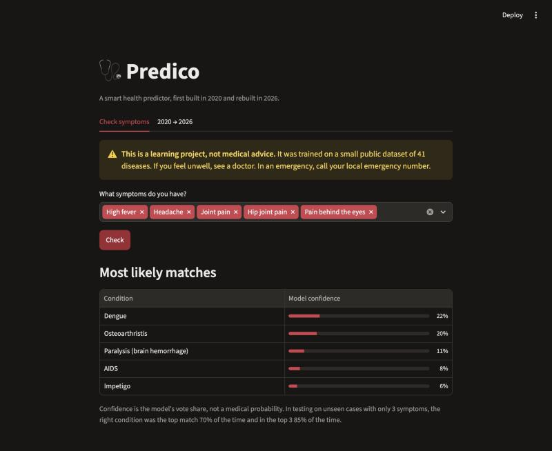
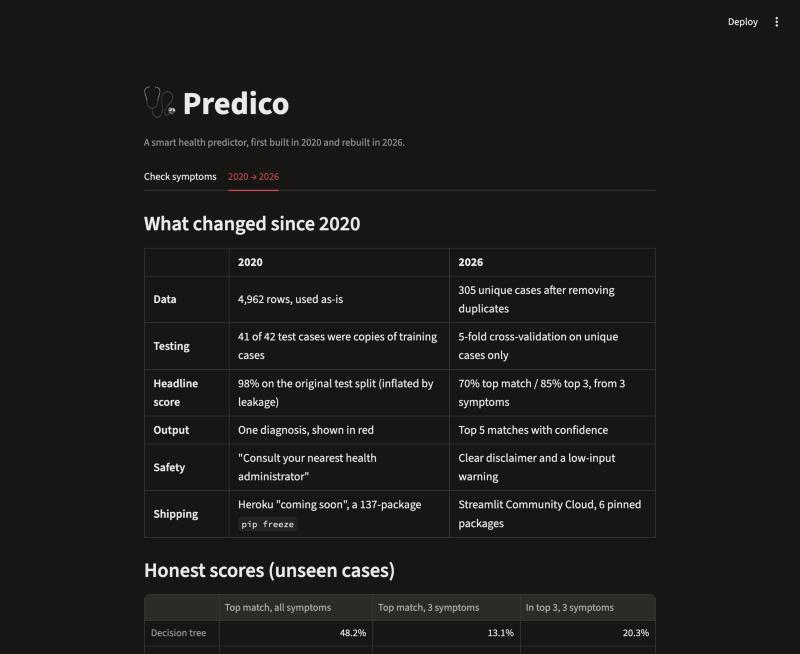

# 🩺 Predico: a smart health predictor

Pick your symptoms, and Predico shows the 5 conditions that match best, with the model's confidence.
I first built it in December 2020 and rebuilt it in 2026 to do it properly.

> ⚠️ **This is a learning project, not medical advice.** It was trained on a small public dataset of 41 diseases.
> If you feel unwell, see a doctor.



## Run it

```bash
python -m venv .venv && source .venv/bin/activate
pip install -r requirements.txt
streamlit run app.py
```

To retrain and re-score the models (this writes `saved_model/model.joblib` and `metrics.json`):

```bash
python main.py
```

**Deploy:** push to GitHub, then on [share.streamlit.io](https://share.streamlit.io) click **Create app** and pick this repo with `app.py`. It's free, and it takes the place of the old "Heroku, coming soon" plan.

## How it works

- **Data:** the public symptom-to-disease CSV: 132 yes/no symptoms and 41 diseases.
- **Cleaning:** removes duplicate rows (4,962 → 305 unique cases) and fixes a broken duplicate `fluid_overload` column.
- **Models:** compares a decision tree, a random forest and naive Bayes with 5-fold cross-validation, then keeps the best.
- **Realistic test:** each unseen case keeps only 3 of its symptoms, because real users don't list 17.

| Model | Top match, all symptoms | Top match, 3 symptoms | In top 3, 3 symptoms |
|---|---|---|---|
| Decision tree | 48% | 13% | 20% |
| **Random forest** ✅ | **100%** | **70%** | **85%** |
| Naive Bayes | 98% | 58% | 73% |

## 2020 → 2026: what changed



### The project

| | 2020 | 2026 |
|---|---|---|
| **Data** | Used as-is | Duplicates removed: only 305 of 4,962 rows were unique |
| **Testing** | 41 of 42 test cases were copies of training cases | Cross-validation on unique cases, plus a 3-symptom test |
| **Headline score** | 98%, but tested on copies of training data | 70% top match, 85% in the top 3, from 3 symptoms |
| **Output** | One diagnosis | Top 5 matches with confidence |
| **Safety** | "Consult your nearest health administrator" | Clear disclaimer and a warning when you enter few symptoms |
| **Code** | `main.py` crashed: a missing import and a model-name mismatch | Runs end to end and saves its own metrics |
| **Dependencies** | A 137-package UTF-16 `pip freeze` (Django, Flask, boto3…) | 6 pinned packages |
| **Hosting** | Heroku, "coming soon" (its free tier ended in 2022) | Streamlit Community Cloud |
| **Streamlit** | 0.79 | 1.67: tabs, progress columns, cached model loading |

### The field

- **Language over checkboxes.** In 2020, symptom checkers used fixed forms. Since LLMs arrived, you describe symptoms in your own words.
- **Ranked answers, not one label.** Good tools now show a ranked list with how sure they are, and say when they don't know.
- **Evaluation grew up.** Removing duplicates, testing on data the model hasn't seen and writing model cards are now the minimum for any published result.
- **Health AI got regulated.** The EU AI Act treats medical AI as high-risk, and regulators such as the FDA now publish guidance for AI in medical devices. Disclaimers and limits are expected, not optional.
- **Shipping got easy.** Free one-click hosts and pinned dependency files replaced hand-built Heroku setups.

### What I learned

1. **Data quality beats model choice.** My 2020 "98%" was measured on copies of the training data, so it proved nothing. The dataset is so tidy that a full symptom list is easy; the real test is a user who reports only 3 symptoms, and there the model gets 70%.
2. **Ship it, and make it reproducible.** A training script that crashes and a "coming soon" deploy are not a finished project.
3. **Health AI must be humble.** Show uncertainty, show alternatives, and never pose as a doctor.
4. **LLMs changed how I build.** I'd start from language today. Predico stays classic ML on purpose: it's small, explainable, free to run and needs no API key.

## Project layout

```
├── app.py               # Streamlit app: symptom check + 2020 → 2026 tab
├── main.py              # Cleans data, scores models, saves the best one
├── config.yaml          # Seeds, model settings, eval settings
├── dataset/             # Original 2020 CSVs (unchanged)
├── saved_model/         # model.joblib + metrics.json
├── docs/                # Screenshots
└── Report.pdf           # Original 2020 project report
```

## License

MIT
